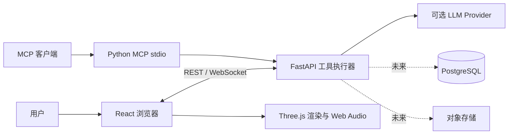
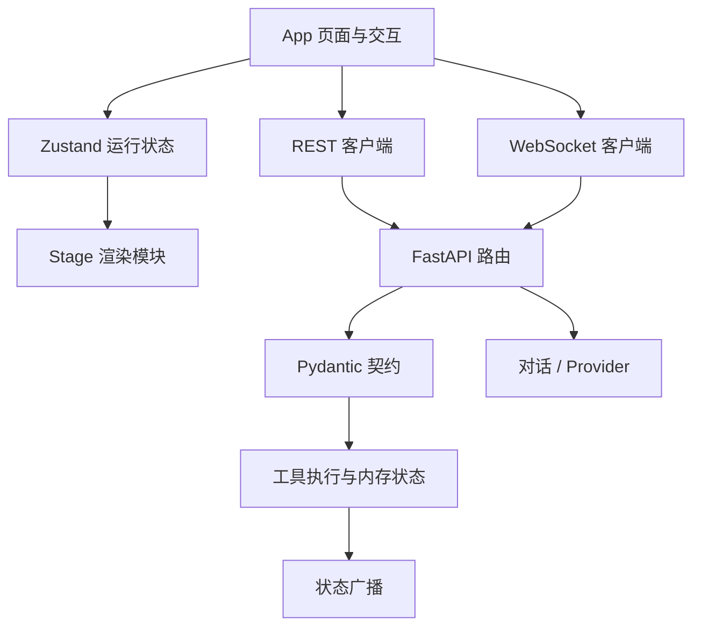
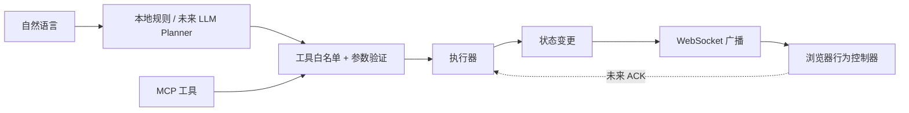
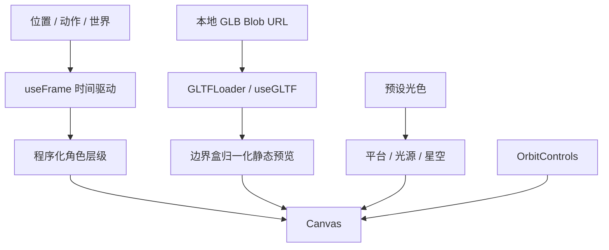
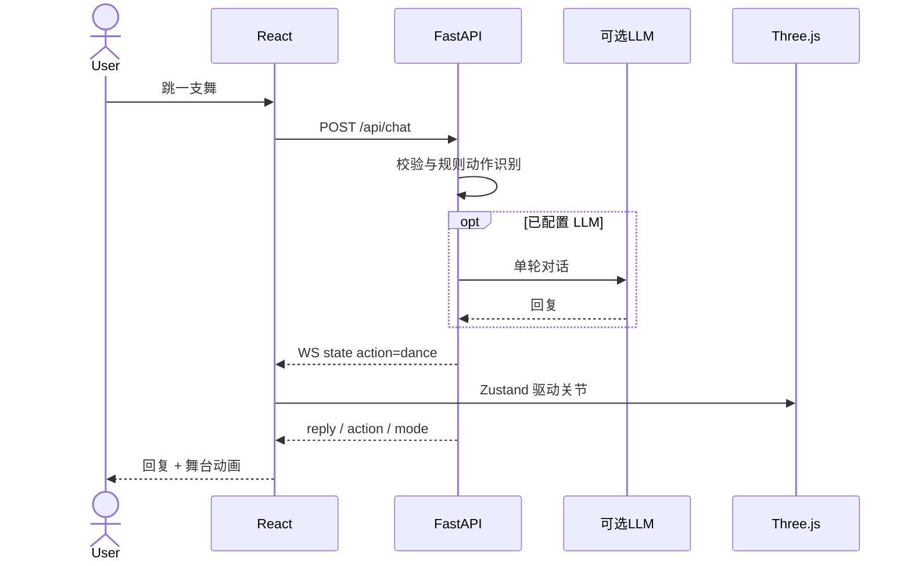
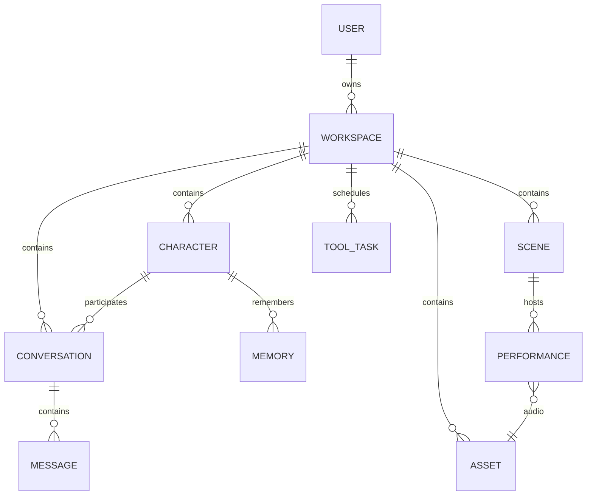

# AstraVerse 产品与工程方案

2026-10-17 · v0.1 基础方案；v0.2 增量实现以 [模型与角色表现说明](MODELS_AND_PRESENCE.md) 为准。本文件区分已交付、本地能力、设计目标与未来功能；以 README 的运行方法为准。

## 1. 产品概述与核心价值

以原创虚拟伙伴为中心，连接对话、音乐表演和空间探索。个人创作者在一个页面内切换伙伴、布置舞台、导入合法资源并通过自然语言或 MCP 控制。首先实现无需模型密钥和授权资产就能体验的本地 MVP，再接入真实 AI 与资产管线。

## 2. 使用场景与核心流程

- 日常陪伴：打开空间 → 选择伙伴 → 文字交流 → 浏览器播报；无模型时明确使用规则回复。
- 音乐体验：上传音频 → 上传 LRC → 播放并显示歌词 → 启动程序化舞蹈。
- 空间创作：切换光色预设或导入 GLB → 旋转镜头/移动角色 → 保存参数或导出 JSON。
- Agent 控制：MCP 客户端发现工具 → 参数校验 → API 更新状态 → WebSocket 广播 → 浏览器渲染。

## 3. 功能清单与优先级

| 优先级 | 能力 | 当前状态 |
|---|---|---|
| P0 | React 工作空间、3D 舞台、角色、镜头与移动 | 已实现，程序化角色 |
| P0 | Python API、规则聊天、工具校验、WS | 已实现 |
| P0 | 资源导入、项目保存 | 本地 GLB/音频/LRC；配置 localStorage |
| P1 | LLM、TTS | 兼容 API 接口/浏览器 TTS；外部服务未实测 |
| P1 | VRM 人形骨骼、表情、口型、记忆 | 待实现 |
| P1 | 音乐播放/歌词/舞蹈 | 已有基础；节奏分析/编排待实现 |
| P1 | MCP 与 Agent | 15 工具注册；部分明确不支持，规则动作识别 |
| P2 | 地图碰撞、重力、navmesh、AI 探索 | 待实现 |
| P2 | 场景层级树与 TransformControls 编辑器 | 待实现 |
| P2 | 用户、云资源、长期记忆、多人 | 待实现 |
| P3 | 实时语音、歌声合成、动作重定向 | 依赖专门管线与授权 |

## 4. 技术选型、兼容性与许可

React 19 + TypeScript + Vite 提供类型与快速本地开发；R3F 9 与 React 19 配套，Three.js 渲染、Drei 镜头/粒子；Zustand 负责轻量运行状态。CSS 变量承担当前设计系统，不为 MVP 引入完整 UI 框架。FastAPI/Pydantic 使用同一个模块化进程，httpx 调用兼容 LLM 接口，官方 MCP Python SDK 固定 v1 主版本（`mcp>=1.12,<2`）。前端在自身目录维护 npm 清单与锁文件；后端独立维护 Python 依赖，部署脚本统一放在 deploy/。

React、Three.js、R3F、Drei、Zustand、FastAPI、MCP SDK 采用宽松开源许可，Lucide 为 ISC；发行前应以锁定版本 license 清单复核。Noto Sans SC / DM Sans 字体遵循各自 OFL，使用系统回退。程序化角色与合成音源由项目代码构建，不使用洛天依或其他授权不明资产。用户上传作品的版权需用户自行拥有。

VRM 拟采用 three-vrm，需逐个核查 VRM 元数据对商业使用/二次分发的限制。Live2D Cubism Web SDK 商业发布须按官方当期许可审查，可用 VRM 替代；不内置 Live2D 运行时。MMD 文件、舞蹈、歌声模型具有独立权利，不因读取器开源而获得授权。PostgreSQL、SQLAlchemy、Alembic、对象存储在多人阶段加入；Redis/队列在确有长任务需求时加入，当前不用微服务。

参考：[R3F 版本配套](https://r3f.docs.pmnd.rs/getting-started/installation)、[官方 MCP Python SDK](https://github.com/modelcontextprotocol/python-sdk)。

## 5. 整体系统架构



当前 API 内存保存一个共享空间；用户侧导入文件不上传。LLM 调用仅发送当前聊天文本和角色人设。

## 6. 前后端模块架构



当前采用三个主要前端模块，避免过度拆分。后续将 App 按 conversation、library、performances、editor 功能域拆开，统一生成 API 类型。后端增长后按 routers/services/domain/repositories 分层，保留单体部署。

## 7. Agent 与 MCP 架构



MCP 不接触 DOM、GPU 或直接执行任意代码，浏览器负责动画与音频。现阶段执行器串行锁保护状态，返回 stored/dispatched 与 render_acknowledged=false；未实现持久队列/取消。未来每条命令增加 id、workspace_id、deadline、cancel_token 与状态 queued/running/completed/failed/cancelled；浏览器 ACK 后才标记完成。跨用户工具需工作空间授权和资源白名单；删除资源、外部付费生成必须单独确认。

## 8. 3D 角色与场景引擎



角色状态：idle/wave/dance/jump。位置采用帧率无关插值；跳跃为演示周期运动，不宣称物理模拟。模型导入只预览；骨骼模型需未来的 VRM Humanoid 适配和 AnimationMixer，避免把通用 GLB 当作可动画人形。GLTF 依赖文件打包、DRACO/KTX2 解码和资源释放预算为后续事项。

## 9. 业务时序与数据流



音频数据流：本地文件 → Blob URL → HTMLAudio → 当前时间 → LRC 时间索引 → 歌词显示。内置音源为 Web Audio 正弦合成和弦。尚无频谱灯光联动、音素口型或真实演唱。

## 10. 数据库设计（未来迁移目标）



USER(id,email,password_hash,created_at)；WORKSPACE(id,owner_id,name,revision)；ASSET(id,workspace_id,kind,storage_key,sha256,size,license,metadata)；CHARACTER(id,workspace_id,asset_id,persona,voice_config)；SCENE(id,workspace_id,objects_json,environment_json,revision)；PERFORMANCE(id,scene_id,audio_asset_id,lyrics_asset_id,timeline_json)；CONVERSATION(id,workspace_id,character_id)；MESSAGE(id,conversation_id,role,text,tokens)；MEMORY(id,character_id,source_id,content,embedding)；TOOL_TASK(id,workspace_id,tool,args,status,error,created_at)。所有查询以 workspace_id 限定；大文件不入关系数据库。

当前无数据库，不能把内存状态或 localStorage 描述为长期云保存。

## 11. REST / WebSocket / MCP 协议

| 接口 | 参数 | 响应 / 错误 |
|---|---|---|
| GET /api/health | 无 | status, mode |
| GET /api/state | 无 | 角色、场景、音乐运行状态 |
| GET /api/tools | 无 | Pydantic JSON Schema 与 planned 列表 |
| POST /api/tools/execute | tool, arguments | status, state, clients, render_acknowledged |
| POST /api/chat | message 1..4000, character <=40 | reply, action, mode；502 Provider 故障 |
| WS /api/ws | command 事件 | state / result / error / speak |

全部是本地单用户接口，无账号认证，不可直接暴露公网。HTTP 404 为未知工具，422 为参数错误，501 为已规划未支持能力。后端 OpenAPI 为当前可执行契约来源；前端仅使用所需字段，未来由 OpenAPI 生成共享类型。

```ts
type CharacterState = {
  character: number; world: 'lunar'|'aurora'|'sunset';
  action: 'idle'|'wave'|'dance'|'jump';
  position: [number, number, number]; playing: boolean; volume: number;
};
type CommandEvent = { type:'command'; tool:string; arguments:Record<string,unknown> };
type StateEvent = { type:'state'; data:CharacterState };
type ProjectConfig = {version:1; character:number;world:string;volume:number;position:[number,number,number]};
// 未来持久契约
interface SceneAsset { id:string; kind:'glb'|'gltf'; uri:string; bounds:number[]; license:string }
interface AnimationState { clipId:string; loop:boolean; speed:number; blendSeconds:number }
interface Performance { id:string; audioId:string; lyricsId?:string; cues:{at:number;action:string}[] }
interface Conversation { id:string; characterId:string; messages:{role:string;text:string}[] }
interface Memory { id:string; sourceMessageId:string; text:string; consent:boolean }
```

WS 建连发快照，断线 4 秒重连。现有常规 UI 状态主要在浏览器，动作命令上传 API；未做完整多端冲突合并。未来引入 revision、command_id、workspace_id、snapshot/resume cursor、指数退避和幂等执行。

v0.2 新增模型注册/能力路由模块、七类模态适配及关节/表情控制，详细协议见 MODELS_AND_PRESENCE.md。基础 MCP 工具模式来自函数签名与 Literal；参数约束仍由 API 再验证。move 为绝对 x/z，范围 -3..3；animate 七个枚举（idle/wave/dance/jump/sit/crouch/sleep）；scene.load 三个预设；speak 文本 1..1000；其余已实现工具不收参数。15 工具的可执行实现位于 apps/astraverse/src/astraverse/integrations/mcp/stdio.py。

## 12. UI/UX 设计系统

- 默认深色：背景 #101115、侧栏 #15161b、面板 #18191f、边框 #292a32；强调 #c0aaee、正文 #e8e7ed、辅助灰紫。
- 字体 DM Sans + Noto Sans SC；无网络时系统 sans-serif。标题 25/22/19，正文 11–13；小字号面向工作室桌面密度，正式无障碍优化应提升辅助文本。
- 基础间距 4，8/12/16/24/32 级；控件圆角 6–8、面板 10–11、对话框 16。
- Lucide 线性图标，常用 16–21；状态兼有文案，不仅依赖颜色。
- 交互 hover 180ms，焦点可见，disabled 降低透明度；尊重 prefers-reduced-motion 的 CSS 动效偏好。3D 循环动画尚未接入该偏好。
- 断点 1550/1180/900/680；宽屏完整侧栏，平板图标导航，手机舞台/聊天纵排和底部播放器。
- 浅色主题当前为实验性反色方案，后续应替换独立色板并测量对比度。

## 13. 页面与组件

创作空间是当前产品入口：固定侧栏 + 面包屑状态栏 + 问候标题 + 3D 主舞台/对话双栏 + 快捷动作 + 世界卡片 + 播放器。虚拟角色、场景、音乐、资源、MCP、设置由对话框提供真实可用入口，未伪装为十套独立完整页面。

产品营销首页、登录/注册、独立工作台、全屏编辑器为后续路由。组件按职责拆分 Stage、Idol、Asset、World、Zustand store；App 集中处理当前 MVP 的页面、会话与本地文件生命周期，规模增长后需拆分。

## 14. 项目目录

```text
AstraVerse/
├── apps/
│   ├── astraverse-web/       # React 前端
│   │   ├── src/{app,features,shared}/
│   │   ├── public/
│   │   ├── scripts/          # 前端边界检查、场景资源生成
│   │   ├── tests/
│   │   ├── package.json
│   │   └── package-lock.json
│   └── astraverse/           # Python 后端
│       ├── src/astraverse/{api,core,modules,integrations}/
│       ├── tests/
│       ├── pyproject.toml
│       └── requirements.lock.txt
├── deploy/                   # setup.sh、start-local.sh、local.py、Docker配置
├── docs/
├── .agents/                  # 被忽略的协作记录与测试产物
├── .local/                   # 被忽略的运行数据与服务日志
└── README.md
```

## 15. 关键文件与扩展职责

Stage 只处理浏览器渲染，不调用 LLM；store 保持可序列化运行状态，Blob URL 仅在浏览器会话内；API 的 execute 是唯一远程工具入口；MCP 只做类型化适配，不复制动作逻辑。未来 animation/audio/navigation 子系统从 Stage/App 中抽出，AI Provider 从 main.py 抽出；数据库迁移只在真实引入数据库时创建，不生成空目录冒充实现。

## 16. 分阶段实施计划

| 阶段 | 目标、依赖与关键文件 | 难点 | 验收与交付 |
|---|---|---|---|
| 1 基础 MVP | 当前 web、api、store、Stage | WebGL、WS、文件预览 | 两服务启动，角色移动，聊天，WS 广播；本次交付 |
| 2 AI 角色 | 基于 1，新增 ai/providers、avatar/vrm、memory | 口型/声音延迟、记忆隐私 | 可切真实模型，SSE 回复，语音输入输出与口型；录制端到端演示 |
| 3 音乐舞蹈 | 基于 1/2，新增 audio/analyzer、animation/timeline | 动作授权/重定向/节拍对齐 | 音频/LRC/骨骼动画同步，暂停 seek 可恢复；演出配置 |
| 4 地图探索 | 基于 1，新增 navigation/physics、navmesh | 复杂地图碰撞与预算 | GLB 加载进度、移动跳跃碰撞、可取消目标寻路；测试地图 |
| 5 MCP Agent | 当前适配基础上扩展 tasks、permissions、planner | 多步执行/超时/取消/幂等 | 15 工具全部实际支持、浏览器 ACK、权限隔离和任务日志 |
| 6 商业优化 | 基于全部，新增 auth/db/storage/observability | 多租户安全、性能、资产权利 | 账号隔离、部署回滚、可访问性审查、设备实测和容量报告 |

每阶段以可运行入口与验收证据结束，未验收不标完成。Phase 2/3 可选择外部服务但须显示价格/授权并单独配置。

## 17. 性能、安全、部署

设计目标（尚非实测）：桌面 60 FPS、移动至少 30 FPS；基础模型压缩后 <10 MB；首次有效舞台 <3 秒（缓存与网络条件需报告）；动作指令本地 p95 <100ms；断线 5 秒内恢复；Provider 30 秒超时；每工作空间并发 AI 请求 1。当前 DPR 限制 1–1.8、低粒子数、Stage 懒加载，构建产物体积由 build 输出记录；不宣称已满足 FPS 指标。

上传本地校验扩展名/类型/可配置单文件上限（默认50 MB，1–2048 MB，当前浏览器持久化），GLB 解析异常由边界 UI 提示。仍须为外部不可信资产增加魔数、几何/纹理预算、解码超时与对象 URL 释放。未来服务端资产先隔离、再校验 MIME/魔数/哈希、病毒扫描和解压上限，使用私有对象存储签名 URL。禁止任意磁盘路径、shell 与任意 URL 加载。

当前后端仅 loopback、WS Origin 白名单；无账号/限流/租户隔离，不能公网服务。生产前需要 JWT/会话 Cookie、CSRF、OAuth 可选、RBAC 工作空间验证、工具配额/审计、密码哈希、按用户隔离记忆、保留与删除策略。API Key 不传前端；日志不记录密钥与聊天全文。公网禁用任意 Provider URL 修改，避免 SSRF；当前只有服务器环境可配置。

部署先模块单体 + 静态前端 + TLS 反向代理；PostgreSQL 持久业务数据，对象存储保存资产，Redis 仅用于确有需要的长任务。当前 Compose 是本地开发环境。后续 CI 运行 tsc/build、pytest、MCP 发现/调用集成、浏览器核心路径和资产许可证检查；生产部署分预览/灰度/回滚并配置异常监控。Docker 构建尚需在具备 Docker 的环境验证。

## 18. 最小可运行实现与验收

按 README 安装，启动 API 与 Vite。先无密钥运行，确保规则助手明确标注；选择角色与世界、WASD、舞蹈、上传音乐、拖进度、保存恢复；后端测试覆盖参数界限、未支持能力、WS 广播、规则聊天与 Origin 拦截。MCP 先启动 API，再由客户端 stdio 启动 server.py，调用 system.get_state/character.dance 查看浏览器变化。外部 LLM 需要用户自有凭据且当前未做在线调用验证。

## 19. 迭代路线

近期：拆分 App 功能域、上传 GLB 进度/资源释放、JSON 导入校验、完整双向 revision 同步、可见性降低渲染频率、真正浅色主题和可访问性改进。中期：VRM 模型、动作管线、流式对话、TTS viseme、音频分析、编辑器。长期：账号与授权资产市场、协作空间、Agent 自动编排与可追溯任务、合法歌声服务。所有新增能力先接明确契约，再交付可验证实现。
